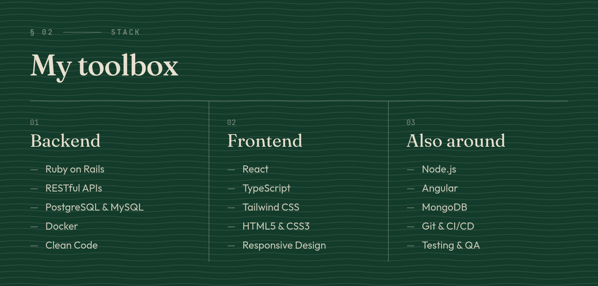
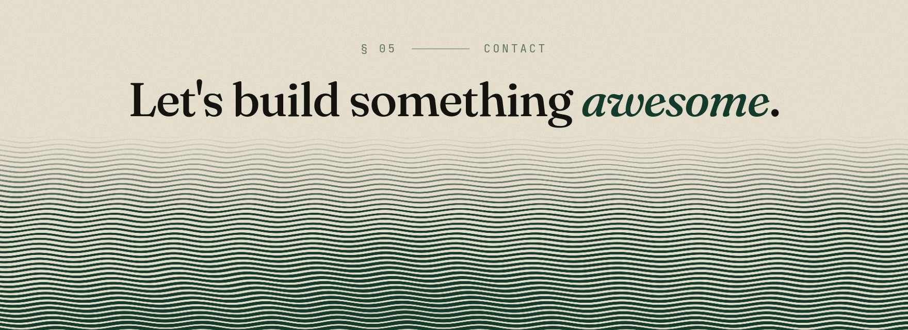

  

<code>§ 01 ——— ABOUT</code>

### Hi there, I'm Vinicius.

I build scalable, well-crafted web applications, from the database to the interface — with a special focus on **Ruby on Rails**, where I found a perfect combination of productivity and performance.

Always interested in deepening my knowledge in web development and improving my craft as a full-stack developer.

 

 

<code>§ 03 ——— SELECTED WORK</code>

### Things I've made

`01` &nbsp; **[Agile Deck](https://github.com/ViniciusLisboa07/agile-deck)** &nbsp;`RUBY ON RAILS APP`  
Create rooms and make your estimates quickly and easily.

`02` &nbsp; **[Lisb](https://github.com/ViniciusLisboa07/lisb)** &nbsp;`RUBY COMPILER`  
Ruby to JavaScript compiler written in Ruby.

`03` &nbsp; **[CondoGenius](https://github.com/CondoGenius/condogenius)** &nbsp;`CONDOMINIUM SYSTEM`  
Condominium management system.

`04` &nbsp; **[Text to Speech](https://github.com/ViniciusLisboa07/nodeJS-text-to-speech)** &nbsp;`NODEJS UTILITY`  
Text to speech converter using NodeJS and Balcon service.

 

<code>§ 04 ——— WRITING</code>

### From the blog

Studies, thoughts and other things that feel like sharing about programming and web development.

- **[Melhores Validações](https://viniciuslisboa07.github.io/blog/melhores-validacoes)** — `DEC 2025`
- **[Pensamentos sobre arquitetura do Rails](https://viniciuslisboa07.github.io/blog/pensamentos-sobre-arquitetura-rails)** — `DEC 2025`
- **[O cão mordendo o próprio rabo](https://viniciuslisboa07.github.io/blog/o-cao-mordendo-o-proprio-rabo)** — `JUL 2025`
- **[Inserção de dados em massa em bancos relacionais](https://viniciuslisboa07.github.io/blog/insercao-de-dados-em-massa)** — `MAY 2023`

→ [Read all posts](https://viniciuslisboa07.github.io/blog)

 

  <a href="https://viniciuslisboa07.github.io">Portfolio</a>
  &nbsp;·&nbsp;
  <a href="https://www.linkedin.com/in/vin%C3%ADcius-lisboa-6347971a9/">LinkedIn</a>
  &nbsp;·&nbsp;
  <a href="https://viniciuslisboa07.github.io/blog">Blog</a>

